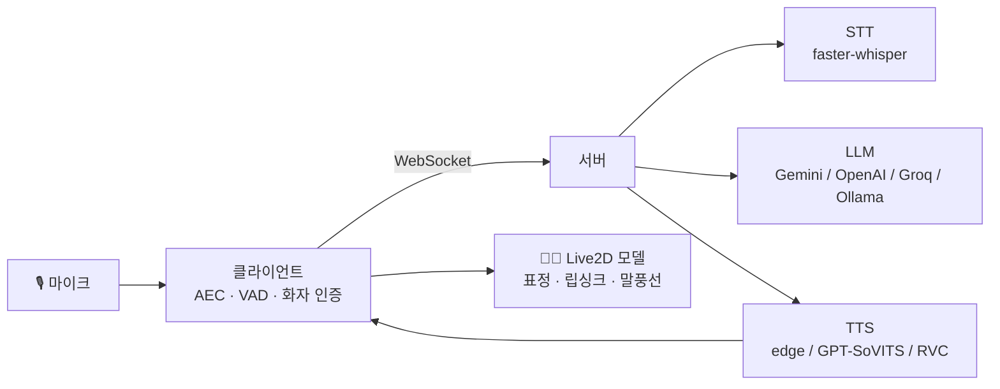

<div align="center">

# 🎤 Project Miku

**Live2D 캐릭터의 스킨을 쓴 AI 어시스턴트**


말을 걸면 듣고, 생각하고, 표정을 지으며, 목소리로 대답합니다.


<!-- 대표 이미지 또는 GIF를 아래 주석을 풀고 경로를 맞춰 넣으세요

-->

[다운로드](../../releases) · [빠른 시작](#-빠른-시작) · [기능](#-주요-기능) · [문서](#-문서)

</div>

---

## ✨ 주요 기능

| | 기능 | 설명 |
|---|---|---|
| 💬 | **대화 (LLM)** | Gemini / OpenAI 호환 / Groq / 로컬 Ollama 중 선택. 최근 대화와 장기 기억을 함께 사용 |
| 🗣️ | **음성 합성 (TTS)** | edge-tts 또는 GPT-SoVITS, 필요하면 RVC 변환. 립싱크 연동 |
| 🎙️ | **음성 인식 (STT)** | faster-whisper를 로컬에서 실행. 외부 STT 서버 불필요 |
| 🔊 | **음성 분석** | Silero VAD, WebRTC AEC3 에코 제거, 화자 인증 |
| 😊 | **표정 · 모션 연동** | 감정 태그를 모델의 표정/모션에 연결. 모델별로 따로 관리 |
| 🧑‍🎤 | **모델별 persona** | 모델마다 캐릭터 설정, 감정 표, 대화 기록, 음성을 따로 저장 |
| 🎵 | **실시간 가사** | 재생 중인 곡을 감지해 가사 표시 (알송 + LRCLIB), 번역 줄 지원 |
| 👀 | **시선 · 화면 공유** | 마우스를 따라보는 시선, 화면 캡처를 보여 주고 대화 가능 |
| ⏰ | **음성 명령 · 알림** | 음악 제어, 볼륨, 일정/타이머, 먼저 말 걸기를 서버 없이 즉시 처리 |
| 🚀 | **통합 런처** | 서버/클라이언트 실행, 설정 편집, 로그, 리소스 확인, 모듈 설치를 한 화면에서 |

<!-- 기능별 스크린샷 자리 (주석을 풀고 사용)
<table>
  <tr>
    <td></td>
    <td></td>
  </tr>
  <tr>
    <td align="center">대화와 표정</td>
    <td align="center">실시간 가사</td>
  </tr>
</table>
-->

## 🎬 데모

[](https://www.youtube.com/watch?v=2FuOO6GZglg)

## 🧩 구성

```
Project_Miku/
├─ Project_Miku_client/     Electron + pixi-live2d-display  (화면, 마이크, 말풍선)
├─ Project_Miku_server/     FastAPI + SQLite                (LLM, 기억, TTS/STT)
└─ Project_Miku_launcher/   PySide6 통합 런처               (실행 · 설정 · 설치)
```



## 📋 요구 사항

- Windows
- LLM API 키 (Gemini / OpenAI / Groq 중 하나) **또는** 로컬 Ollama
- (직접 실행할 때만) Python 3.10 이상, Node.js
  - 런처로 설치하면 필요한 Python과 Node.js를 자동으로 받습니다.

### 권장 사양

아래 수치는 대략적인 기준입니다. 모델 양자화 방식과 대화 길이(컨텍스트)에 따라 요구 사양이 달라집니다.

**웹 LLM 사용 (Gemini / OpenAI / Groq)**

| 구성 | 최소 | 권장 |
|---|---|---|
| 기본 (대화 + edge-tts) | CPU 4코어, RAM 8GB, GPU 없음 | RAM 16GB |
| + 음성 인식 (faster-whisper) | RAM 8GB (CPU로 실행, 느림) | RAM 16GB, NVIDIA GPU VRAM 4GB 이상 |
| + GPT-SoVITS / RVC | NVIDIA GPU VRAM 6GB | NVIDIA GPU VRAM 8GB 이상, RAM 16GB 이상 |

- 디스크 여유 공간 5GB 이상 (음성 모델은 별도)

**로컬 LLM 사용 (Ollama + Gemma 4)**

Ollama 0.20 이상이 필요합니다. VRAM은 4비트 양자화(Q4) 기준이고, 음성 인식이나 GPT-SoVITS / RVC를 같이 쓰면 그만큼 더 필요합니다.

| 모델 | 명령어 | VRAM | RAM |
|---|---|---|---|
| E2B | `ollama run gemma4:e2b` | 4GB | 8GB |
| E4B | `ollama run gemma4:e4b` | 6~8GB | 16GB |
| 12B | `ollama run gemma4:12b` | 8GB (빠듯함) / 12GB 권장 | 16GB |
| 26B (MoE) | `ollama run gemma4:26b` | 16GB 이상 | 32GB |
| 31B | `ollama run gemma4:31b` | 24GB 이상 | 32GB |

- NVIDIA GPU를 권장합니다.
- 음성 기능까지 함께 쓴다면 **VRAM 12GB 이상**에서 E4B 또는 12B를 추천합니다.

**AMD 그래픽카드를 쓴다면**

- 로컬 LLM은 Ollama의 AMD(Radeon) 지원으로 GPU 가속이 가능합니다.
- 음성 인식(faster-whisper), GPT-SoVITS, RVC는 NVIDIA(CUDA) 기준이라 AMD에서는 CPU로 동작하여 느립니다. 별도의 설정이 필요합니다.

<details>
<summary><b>AMD에서 RVC / GPT-SoVITS를 GPU로 돌리는 방법 (직접 설정, 런처 미지원)</b></summary>

AMD가 제공하는 Windows용 PyTorch(ROCm)로 바꾸면 됩니다. RX 9070 / 9070 XT / 9060 XT, RX 7900 XTX 등이 공식 지원 목록에 있습니다. 아직 프리뷰 단계라 아래 내용은 바뀔 수 있고, 이 프로젝트에서 직접 검증하지는 못 했습니다.

1. 그래픽 드라이버를 25.20.01.14 이상으로 설치합니다.
2. **Python 3.12**가 필요합니다. 쓰려는 환경(RVC는 `tools/rvc/venv`)의 Python이 3.12인지 확인합니다.
3. 그 환경을 켜고 기존 torch를 지운 뒤, AMD 휠을 설치합니다. 최신 주소는 [AMD 문서](https://rocm.docs.amd.com/projects/radeon-ryzen/en/latest/docs/install/installrad/windows/install-pytorch.html)를 확인하세요.

```bash
pip uninstall torch torchvision torchaudio
pip install --no-cache-dir https://repo.radeon.com/rocm/windows/rocm-rel-6.4.4/torch-2.8.0a0%2Bgitfc14c65-cp312-cp312-win_amd64.whl
pip install --no-cache-dir https://repo.radeon.com/rocm/windows/rocm-rel-6.4.4/torchaudio-2.6.0a0%2B1a8f621-cp312-cp312-win_amd64.whl
pip install --no-cache-dir https://repo.radeon.com/rocm/windows/rocm-rel-6.4.4/torchvision-0.24.0a0%2Bc85f008-cp312-cp312-win_amd64.whl
```

4. 인식됐는지 확인합니다. `True`가 나와야 합니다.

```bash
python -c "import torch; print(torch.cuda.is_available())"
```

5. PyTorch에서는 AMD GPU도 `cuda`라는 이름으로 보입니다. RVC나 GPT-SoVITS 설정에 장치(device) 항목이 있으면 `cuda`(또는 auto)로 두세요. GPT-SoVITS도 쓰는 Python 환경에 같은 방법을 적용하면 됩니다.

- 다른 패키지를 설치하다가 torch가 CUDA/CPU용으로 다시 덮어써질 수 있습니다. 그러면 3번을 다시 하세요.
- 런처의 설치 탭에서 RVC를 다시 설치하거나 업데이트하면 torch가 원래대로 돌아올 수 있습니다.
- 에러가 나면 `numpy<2`로 낮춰 보세요.

</details>

## 🚀 빠른 시작

### 방법 1. 런처로 한 번에 (추천)

1. [Releases](../../releases)에서 `MikuLauncher.exe`를 다운합니다.
2. 'Project_Miku_server/config.example.yaml'의 사본을 만든 다음, 파일 이름을 'config.yaml'로 고칩니다.
3. **설치** 탭에서 서버 패키지와 클라이언트를 설치합니다. (음성 인식, RVC, GPT-SoVITS는 선택 설치)
4. **서버 설정** 탭에서 LLM 제공자와 API 키를 입력합니다.
5. **런처** 탭에서 서버와 클라이언트를 켭니다.

### 방법 2. 직접 실행

폴더 세 개를 나란히 둔 채로 진행하세요.

```bash
# 1) 서버
cd Project_Miku_server
python -m venv venv
venv\Scripts\activate
pip install -r requirements.txt
copy config.example.yaml config.yaml    # 열어서 api_key 입력
python server.py

# 2) 클라이언트 (새 터미널)
cd Project_Miku_client
npm install
npm start
```

<details>
<summary><b>LLM 제공자별 설정 예시</b></summary>

`Project_Miku_server/config.yaml`에서 `llm.provider`를 고릅니다.

| 제공자 | 값 | 비고 |
|---|---|---|
| Google Gemini | `gemini` | `llm.gemini.api_key` |
| OpenAI 호환 | `openai` | OpenAI, OpenRouter, 로컬 서버 등 (`base_url` 지정) |
| Groq | `groq` | `llm.groq.api_key` |
| Ollama | `ollama` | 로컬 실행, API 키 불필요 |

</details>

## 🧑‍🎤 나만의 캐릭터 만들기

1. `Project_Miku_client/models/<모델이름>/`에 Live2D 모델 폴더를 넣습니다. (VTube Studio 모델 폴더 그대로 사용 가능하며, 편집 역시 가능합니다.)
2. 모델 폴더 안에 `persona.txt`를 만들어 캐릭터 설정을 적습니다(클라이언트의 설정창의 **모델** 탭에서도 작성 가능). 호칭과 이름도 여기에 적습니다.
3. `emotionAliases.json`으로 감정 태그와 표정을 연결합니다. 위와 마찬가지로 클라이언트 설정창에서 고를 수도 있습니다.
4. 트레이 메뉴나 모델을 우클릭하여 모델을 선택하면 끝입니다.

예시 파일은 `persona_example.txt`, `emotionAliases_example.json`에 있습니다.

## 📚 문서

| 문서 | 내용 |
|---|---|
| [설치 및 설정 가이드](https://github.com/tetomikubobim/Project_Miku/wiki) | 설치 방법 및 설정에 대해 자세하게 기술된 가이드 |
| [클라이언트](Project_Miku_client/README.md) | 모델 추가, 감정 연결, 설정 창 |
| [음성 명령 가이드](Project_Miku_client/COMMANDS.md) | 음악, 볼륨, 일정, 먼저 말 걸기 |
| [서버](Project_Miku_server/README.md) | `config.yaml` 설명, STT/TTS, 기억 |
| [런처](Project_Miku_launcher/README.md) | 설치 탭, 설정 편집, 로그, 종료 방식 |

## 🙏 참고한 프로젝트
- [Open-LLM-VTuber](https://github.com/Open-LLM-VTuber/Open-LLM-VTuber.git) 

## 🔒 개인 설정 파일

`config.yaml`(API 키), `config.json`, `launcher.json`은 개인 설정이라 저장소에 올라가지 않습니다 (`.gitignore`).

기본값은 `config.example.yaml`, `config.default.json`에 있습니다.

## ⚠️ 알아두세요

- GPT-SoVITS와 RVC의 **음성 모델은 포함되어 있지 않습니다.** 사용하려는 목소리의 사용 권한을 직접 확인하고 준비해 주세요.
- 런처의 **설치** 탭에서 **츠쿠요미쨩RVC**(つくよみちゃん公式RVCモデル)을 내려받을 수 있습니다. 다운로드 경로는 공식 사이트(https://tyc.rei-yumesaki.net/) 의 배포 경로를 따릅니다. 

## 📄 라이선스

- 직접 작성한 코드는 [MIT](LICENSE.md)입니다.
- Live2D Cubism Core, Hiyori 샘플 모델 등 설치 중 받는 패키지·모델은 각자의 라이선스를 따릅니다.
- 자세한 내용은 [THIRD_PARTY_NOTICES.md](THIRD_PARTY_NOTICES.md)를 확인하세요.
